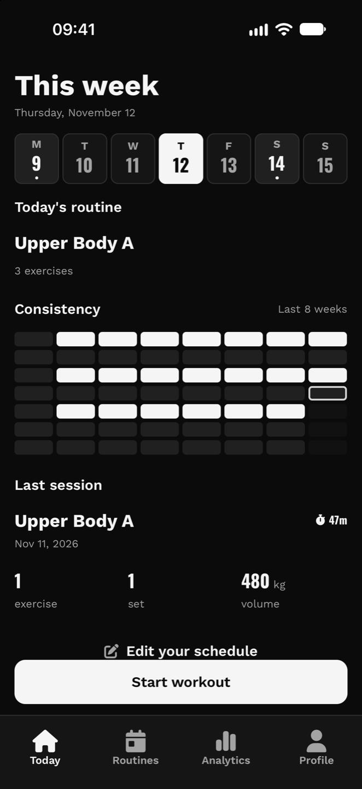
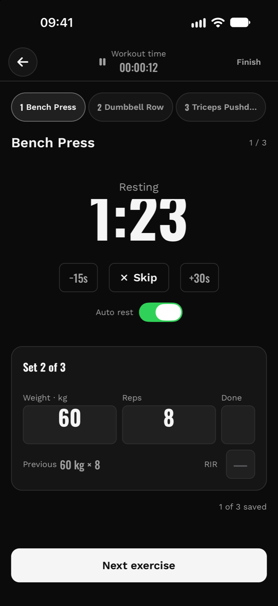
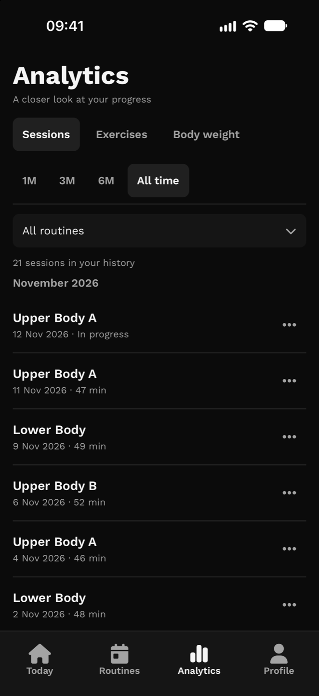
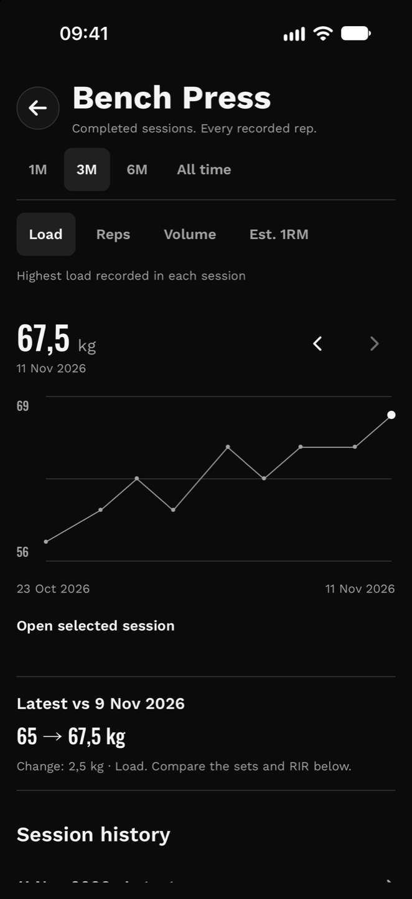
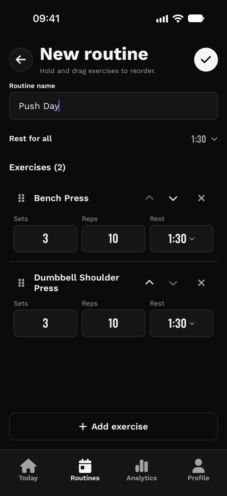
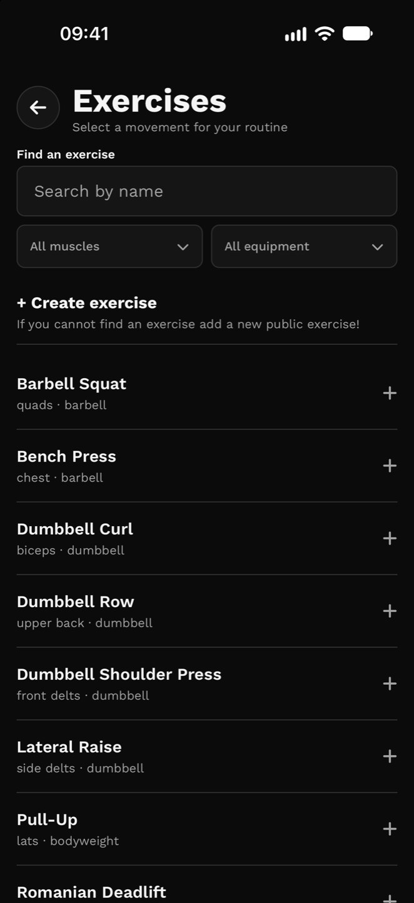

<div align="center">
  
  <h1>ZeroBuff</h1>
  <p>Plan strength workouts, log every set, and see how your lifts progress.</p>
  <p>
    <a href="#features">Features</a> ·
    <a href="#screenshots">Screenshots</a> ·
    <a href="#run-locally">Run locally</a> ·
    <a href="#contributing">Contributing</a> ·
    <a href="#license">MIT License</a>
  </p>
</div>

ZeroBuff is an open-source workout tracker for iOS and Android. Build a routine around your own training plan, schedule it for the week, and compare what you lifted today with what you lifted last time.

## Features

| Feature | What you can do |
| --- | --- |
| **Build routines** | Pick exercises from the shared catalog or create your own. Set the exercise order, sets, reps, and recovery time. |
| **Plan your week** | Assign routines to weekdays. Open Today to see what’s scheduled, start a workout, or resume one in progress. |
| **Log workouts live** | Switch exercises as equipment becomes available. Record load, reps, and optional reps in reserve (RIR), with previous sets for reference. |
| **Time your recovery** | Start a rest timer manually or automatically after saving a set. Get an alert when recovery ends. |
| **Review your progress** | Browse and edit past sessions, track load, reps, volume, and estimated one-rep max by exercise, and log body weight. |
| **Recover an interrupted workout** | Reopen the app to recover an active workout draft. A connection is required to save sets to the server. |

## Screenshots

<table>
  <tr>
    <th scope="col">Today</th>
    <th scope="col">Active workout</th>
    <th scope="col">Analytics</th>
  </tr>
  <tr>
    <td align="center"></td>
    <td align="center"></td>
    <td align="center"></td>
  </tr>
</table>

<table>
  <tr>
    <th scope="col">Exercise progress</th>
    <th scope="col">Create a routine</th>
    <th scope="col">Exercise catalog</th>
  </tr>
  <tr>
    <td align="center"></td>
    <td align="center"></td>
    <td align="center"></td>
  </tr>
</table>

*Captured on the iOS simulator with demo data.*

## Run locally

You’ll need Docker with Compose, Python 3.14 with [uv](https://docs.astral.sh/uv/), and Node.js 26 with npm. For a native simulator or emulator build, use Xcode for iOS or Android Studio for Android.

### 1. Start PostgreSQL and the API

Clone the repository and start the local database:

```bash
git clone https://github.com/salvoZero4/ZeroBuff.git
cd ZeroBuff/backend
cp .env.example .env
uv sync --frozen
docker compose up -d db
```

Once PostgreSQL is ready, run these commands from `backend/`:

```bash
uv run alembic upgrade head
uv run python -m scripts.import_catalog
uv run uvicorn app.main:app --reload
```

The import seeds the exercise catalog. The API runs at [localhost:8000](http://localhost:8000), with interactive [Swagger docs](http://localhost:8000/docs) and [ReDoc](http://localhost:8000/redoc). For a physical device on your local network, start Uvicorn with `--host 0.0.0.0`.

### 2. Run the app

In a second terminal, from the repository root:

```bash
cd mobile
npm ci
cp .env.example .env
```

Set `EXPO_PUBLIC_API_URL` in `mobile/.env` to the address the app can reach. Use `http://localhost:8000` on the iOS simulator, `http://10.0.2.2:8000` on the standard Android emulator, or your computer’s LAN address on a physical device. The client adds `/v1`.

```bash
npm run ios       # iOS simulator
# npm run android # Android emulator
```

These commands build the native modules needed for background rest notifications and Live Activities. See the [mobile setup notes](mobile/README.md) for EAS and platform details.

## Project structure

| Path | What’s inside |
| --- | --- |
| [`mobile/`](mobile/) | React Native, Expo Router, TypeScript, TanStack Query, and Zustand. |
| [`backend/`](backend/) | FastAPI, SQLModel, PostgreSQL, and Alembic. The API is versioned under `/v1`. |
| [`.github/workflows/`](.github/workflows/) | GitHub Actions for mobile checks, backend tests, and backend deployment. |

## Contributing

Open an [issue](https://github.com/salvoZero4/ZeroBuff/issues) to report a bug or discuss a change. For app bugs, include your platform, the steps to reproduce, and what you expected. Keep pull requests focused and run the checks for the part you changed.

**Mobile**

```bash
cd mobile
npm run lint
npm exec -- tsc --noEmit
node --test tests/*.test.cjs
```

**Backend**

```bash
cd backend
docker compose up -d db_test
uv run pytest
```

The backend suite applies migrations to the test database. Use the local environment templates and keep credentials out of commits and issue reports.

## License

ZeroBuff is available under the [MIT License](LICENSE.md).
